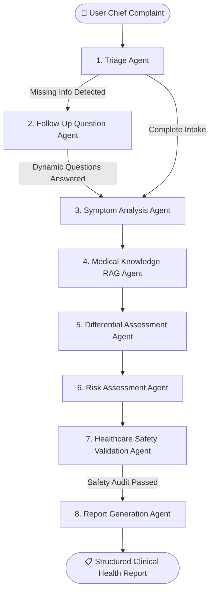

# 🩺 MediAgent — Healthcare Diagnosis Assistant
> **An Agentic AI Healthcare Decision-Support SaaS Platform**  
> *Developed as an Agentic AI Lab Project*

[](https://nextjs.org/)
[](https://www.typescriptlang.org/)
[](https://tailwindcss.com/)
[](https://supabase.com/)
[](https://ai.google.dev/)
[](LICENSE)

---

## 📌 Overview

**MediAgent** is a production-quality, multi-agent AI SaaS web application designed to help users understand their reported symptoms. Unlike simple LLM wrappers or generic chatbots, MediAgent implements a **multi-agent clinical reasoning pipeline** orchestrating 8 specialized agents to collect structured information, ask dynamic follow-up questions, retrieve verified medical knowledge (RAG), evaluate differential possibilities, calculate care urgency, enforce healthcare safety guardrails, and compile structured clinical reports.

> ⚠️ **IMPORTANT MEDICAL DISCLAIMER:**  
> MediAgent is an **educational and decision-support assistant**, NOT an autonomous doctor. It does NOT provide definitive diagnoses, does NOT prescribe medications or dosages, and is NOT a substitute for professional clinical care. In the event of potentially serious warning signs, it prominently recommends immediate emergency evaluation.

---

## 🤖 Multi-Agent AI Architecture

MediAgent does not rely on a monolithic prompt. It operates as an asynchronous state machine where distinct, specialized agents pass state through a typed orchestrator:



### The 8 Specialized Clinical Agents

| # | Agent | Role & Responsibility | Core Output |
|---|---|---|---|
| **1** | **TriageAgent** | Analyzes initial raw complaints, identifies symptom categories, detects missing details, and screens for initial red flags. | Initial risk tier, missing information list, red flags. |
| **2** | **FollowUpAgent** | Formulates 4–6 high-yield questions (scales, boolean toggles, selects, text) targeting key diagnostic criteria. | Dynamic questionnaire with input types and rationale. |
| **3** | **SymptomAnalysisAgent** | Synthesizes raw complaints and user responses into normalized, structured medical data. | Standardized symptoms with duration, severity, location, triggers. |
| **4** | **MedicalKnowledgeAgent (RAG)** | Queries verified clinical guidelines (NICE, CDC, ACEP, AHA) in PostgreSQL to attach authoritative medical evidence. | Retrieved clinical citations and evidence snippets (no hallucinations). |
| **5** | **DifferentialAssessmentAgent** | Formulates 2–4 possible clinical explanations with supporting symptoms, counter-indications, and missing clinical tests. | Differential conditions array with explicit diagnostic uncertainty. |
| **6** | **RiskAssessmentAgent** | Evaluates severity and assigns care urgency (`routine`, `soon`, `urgent`, `emergency`) with explicit warning flags. | Urgency level, care setting, timeframe, and red flags to monitor. |
| **7** | **SafetyValidationAgent** | Audits the entire assessment against medical AI guardrails: verifies non-definitive phrasing and ensures zero prescriptions/dosages. | Safety approval status, issue flags, disclaimer verification. |
| **8** | **ReportAgent** | Compiles a patient-friendly clinical report with structured symptoms, condition cards, questions for the doctor, and disclaimers. | Comprehensive final report persisted to database. |

---

## 🛡️ Clinical Safety Guardrails

MediAgent is built from the ground up with clinical AI safety constraints:

* **Non-Definitive Phrasing:** The system strictly prohibits statements like *"You have X disease."* It enforces language such as *"possible explanation"*, *"may be consistent with"*, and *"could be associated with"*.
* **Zero Medication Prescriptions:** The system is barred from prescribing pharmaceutical drugs or recommending specific dosages.
* **Diagnostic Uncertainty:** Highlights missing laboratory or physical examinations that only an in-person physician can perform.
* **Emergency Red Flag Escalation:** Symptoms indicative of acute coronary syndrome, stroke (FAST criteria), acute appendicitis, thunderclap headaches, or anaphylaxis trigger prominent emergency warnings to call 911/emergency services immediately.
* **Free-Tier Quota & Rate-Limit Engine:** Centralized backoff handler in `src/lib/gemini.ts` ensures rate-limit quotas never crash workflows.

---

## 🛠️ Technology Stack

* **Frontend:** [Next.js](https://nextjs.org/) (App Router), [React](https://react.dev/), [TypeScript](https://www.typescriptlang.org/), [Tailwind CSS](https://tailwindcss.com/), [Lucide React](https://lucide.dev/), [Shadcn UI](https://ui.shadcn.com/)
* **Backend:** Next.js Route Handlers & Server Actions
* **Database & Auth:** [Supabase](https://supabase.com/) (PostgreSQL with Row-Level Security, Supabase Auth)
* **AI Orchestration:** Google Gemini 2.5 Flash via `@google/genai` with a custom TypeScript State-Machine Orchestrator
* **Schema Validation:** [Zod](https://zod.dev/) for structured JSON validation
* **Vector & Knowledge Base:** Supabase PostgreSQL with seeded clinical guidelines

---

## 📂 Application Route Structure

* `/` — Landing page with hero, multi-agent architecture breakdown, features, safety principles, and pricing.
* `/login` & `/signup` — Supabase Auth with double-submit prevention and structured error display.
* `/dashboard` — User dashboard showing recent health assessments, quick actions, and health profile status.
* `/assessment/new` — Clinical intake form (chief complaint, duration, severity, relevant medical context).
* `/assessment/[id]` — Dynamic questionnaire rendering interactive controls (1–10 pain scales, Yes/No toggles, selection pills).
* `/assessment/[id]/processing` — Animated visual multi-agent processing pipeline showing live progress of each agent.
* `/report/[id]` — Final clinical report featuring urgency banners, differential possibility cards, doctor questions, and print/PDF export.
* `/history` — Historical health assessment log with urgency tags and status filters.
* `/profile` — Patient profile manager (allergies, medical history, medications, biological sex).
* `/pricing` — SaaS subscription tiers (Free Lab, Health Pro, Clinic & Team).
* `/admin` — Agent monitoring ops dashboard with latency metrics, success rates, and live audit logs.

---

## 🚀 Getting Started

### Prerequisites

* [Node.js](https://nodejs.org/) (v20 or v22 recommended)
* A [Supabase](https://supabase.com/) project
* A [Google AI Studio](https://aistudio.google.com/) Gemini API key

### 1. Clone the Repository

```bash
git clone https://github.com/Aman-tez-24/MediAgent.git
cd MediAgent
```

### 2. Install Dependencies

```bash
npm install
```

### 3. Configure Environment Variables

Create a `.env` file in the root directory based on `.env.example`:

```env
NEXT_PUBLIC_SUPABASE_URL=https://your-supabase-project.supabase.co
NEXT_PUBLIC_SUPABASE_ANON_KEY=your-supabase-anon-key
SUPABASE_SERVICE_ROLE_KEY=your-supabase-service-role-key
GEMINI_API_KEY=your-gemini-api-key
```

### 4. Database Setup & Knowledge Base Seeding

1. Run the database migration script in `supabase/migrations/00000000000000_init.sql` inside your Supabase SQL Editor.
2. Seed the medical guidelines knowledge base:

```bash
npm run seed:knowledge
```

### 5. Start the Development Server

```bash
npm run dev
```

Open [http://localhost:3000](http://localhost:3000) in your browser.

---

## 💻 Running the Multi-Agent Pipeline via Terminal

You can test and demonstrate the full 8-agent clinical reasoning pipeline directly in your terminal at any time:

```bash
npm run agent:run
```

This runs a simulated patient scenario through Triage, Follow-up, Symptom Analysis, Medical RAG, Differential Evaluation, Risk Urgency, Safety Audit, and Report Generation with live latency benchmarks and structured outputs.

---

## 📄 License

This project is licensed under the MIT License — see the [LICENSE](LICENSE) file for details.
